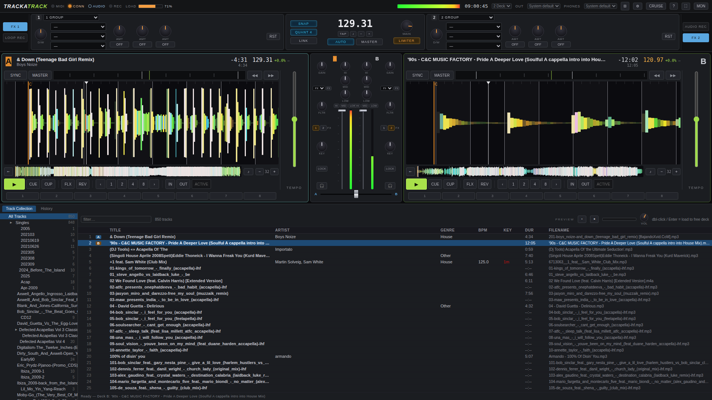

# TRACKATRACK

**A DJ app that lives in your browser.** Vanilla ES modules — no build step, no
framework, no `npm install`. One Python file serves the app *and* your music
folder; a Pioneer controller drives it over Web MIDI, and your browser tab is
the mixer.



> **Alpha.** Two decks, one controller (Pioneer DDJ-SR), Linux + PipeWire and
> Chrome are the tested combination. The UI imitates NI Traktor Pro 2-deck view.

## Features

- **Two decks** — synced waveforms (peak-stacked, colored per deck), BPM &
  beatgrid analysis in a Web Worker, key display, master tempo
- **Performance controls** — CUE / PLAY / CUP / FLIP / REV, 8 hot cues, loop
  in/out, beat-loop ladders, slip, key-lock, pitch bend & platter scratch
- **Traktor-style FX** — two global FX Units + per-channel mixer FX, pattern
  player for lfo-style mods
- **Mixer** — channel EQ/gain/fader, crossfader, master limiter, master meter
- **Headphone cueing** — independent cue bus with MIX (cue↔master blend) and
  VOL, PFL per channel (the CUE buttons above the channel faders)
- **Collection** — server-side scan with ID3 tags, folder tree, search/sort,
  BPM/key columns; loads over HTTP, decodes with ffmpeg fallback for corrupt MP3s
- **Recording** — audio recorder + loop recorder, downloadable takes
- **CRUISE mode** — auto-plays the next track in the list
- **MIDI learn & monitor** — built-in MON panel; mappings generated from the
  Mixxx database (`tools/gen-mapping.py`)

## Requirements

- **Google Chrome or Chromium** on the machine with the controller (needs
  Web MIDI, AudioWorklet and `AudioContext.setSinkId`). Safari/iOS won't do
  Web MIDI without a flag; Firefox has no Web MIDI.
- **Python 3** (stdlib only) on the same machine — that's the whole server.
- A **Pioneer DDJ-SR / DDJ-SX** class controller. The mapping auto-generates
  from Mixxx's DDJ-SX definition with SR-specific overrides.

## Run

```bash
cd trackatrack
python3 server.py --port 8443 --ssl
# open https://<machine-ip>:8443  (accept the self-signed cert once)
```

Flags: `--host` (bind address), `--music-dir` (default `~/Music`), `--rescan`
(force re-scan of the collection), `--ssl`, `--san` (extra cert SAN entries).
There is a plain-HTTP mode too (`python3 server.py --port 8360`) but Web MIDI
and `setSinkId` want the secure origin.

After editing any JS/CSS: just **Ctrl+F5**. There is no build.

## Sound routing (read this once)

The header bar has two dropdowns, **OUT** (main speakers) and **PHONES**
(headphone cue). Choices are stored in **cookies**, so each browser remembers
its own routing — handy when trackatrack is used remotely.

- **First load:** Chrome hides device names and hands out throwaway device ids
  until you allow microphone access once. Click anywhere on the page and allow
  the prompt — nothing is recorded; it only unlocks names and stable ids (the
  cookies need those to restore your choice).
- **DDJ-SR owners:** over USB the controller is *one* 4-channel device
  (channels 1–2 = master out, 3–4 = phones jack), so it appears once in each
  dropdown — browsers cannot offer "channel 3/4" as a separate entry. When
  both dropdowns pick the DDJ-SR, trackatrack opens a **single 4-channel
  stream** and parks the cue mix on the rear pair. The DDJ-SR's own phones
  source switch must monitor **3/4** (or Mixing).
- **If the phones jack stays stubborn,** pick your **laptop's built-in output**
  for PHONES instead — the cue then comes from the laptop speakers/headphones
  (slightly delayed) while the main mix keeps running through the controller.
  This is a perfectly fine setup and needs no controller switch fiddling.
- The **CUE button above each channel fader** (not the deck Cue!) is PFL: it
  sends that channel to the phones with its strip lit.

## Controller (DDJ-SR)

| Control | Does |
| --- | --- |
| Deck CUE / PLAY / CUP / FLIP / REV | transport as labelled |
| Hot cues 1–8, LOOP IN/OUT, beats | as labelled, quantized by master tempo |
| Top platter (touch + turn) | **scratch**; release restores pitch |
| Ring / turn without touch | pitch **bend** (auto-decays) |
| Channel CUE (above fader) | headphone PFL (lights the strip) |
| SHIFT + knob/button | secondary function per Mixxx mapping |
| FX knobs (14-bit) | trim on the two global FX units |

Keys with no hardware (vinyl mode, slip, etc.) are available in the UI.
The MON panel shows every incoming message; MIDI-learn lets you rebind.

## Repository layout

```
server.py          tiny HTTP server: app + /audio + ffmpeg /decode fallback + library API
index.html         single page — grid layout, templates for deck/strip/fx units
css/app.css        dark Traktor-style theme
js/main.js         boot, mixer, MIDI dispatch switch, rAF paint loop
js/audio/          engine.js (master+cue buses, FX), deck.js (transport/loops/scratch), worklet
js/midi/           mapping (generated) + SR overrides + hub + MON panel
js/library.js js/waveform.js js/ui.js js/analysis/ ...
tools/             cdp_eval.py + reg.js (headless e2e), shot.py, gen-mapping.py
docs/screenshot.png
```

## Development

There is no test framework — there is a headless end-to-end script that drives
Chrome over CDP, loads real tracks on both decks and asserts on real audio:

```bash
python3 server.py --port 8360 &
python3 tools/cdp_eval.py http://127.0.0.1:8360 "$(cat tools/reg.js)"   # expect mPeak > 0, errs: []
```

Contributors should read **[AGENTS.md](AGENTS.md)** first: it documents the
audio-graph gotchas, the MIDI mapping pipeline and the layout ground rules.

## Known limitations (alpha)

- Two decks, full stop (the layout selector only offers "2 Deck" for now)
- Tested on Linux + PipeWire + Chrome; other hosts unexplored
- Some MP3s in the wild are too corrupt for Chrome's decoder; the server
  transparently re-decodes them to WAV via ffmpeg (`/decode/`)
- The cue stream through a second browser audio output adds noticeable latency
  (the single-stream DDJ route avoids it)
